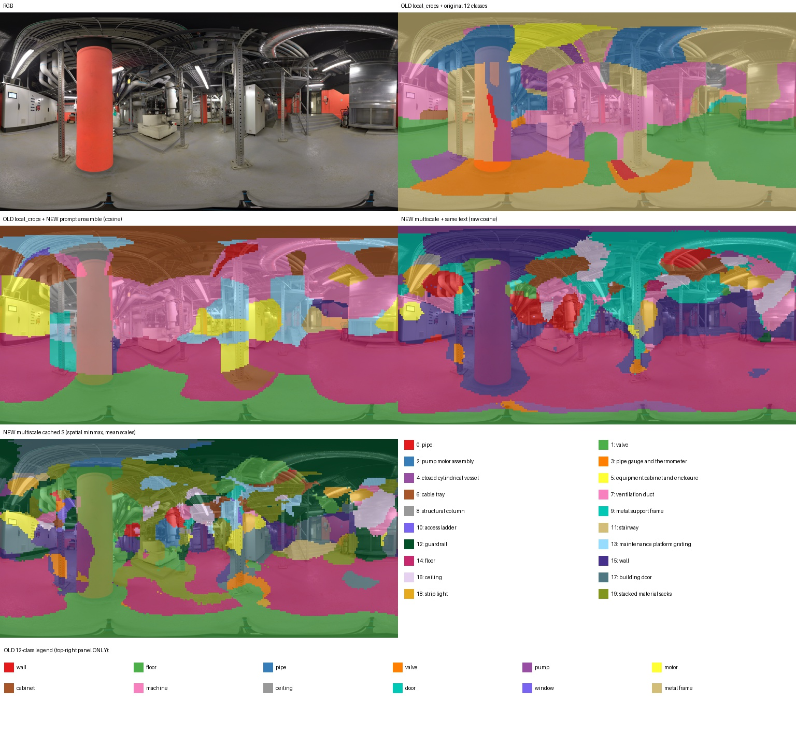
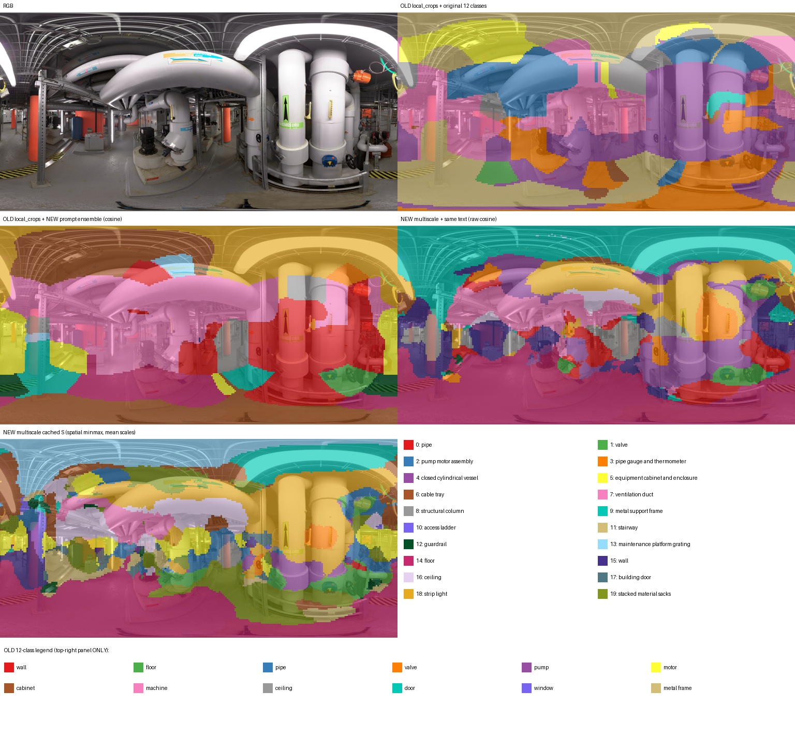
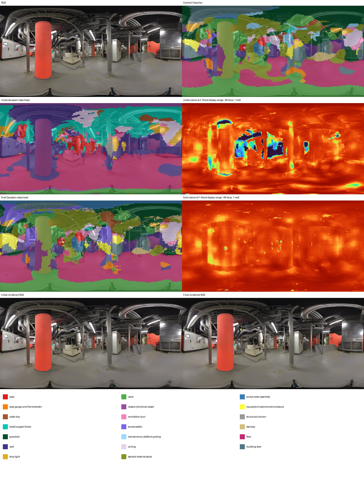
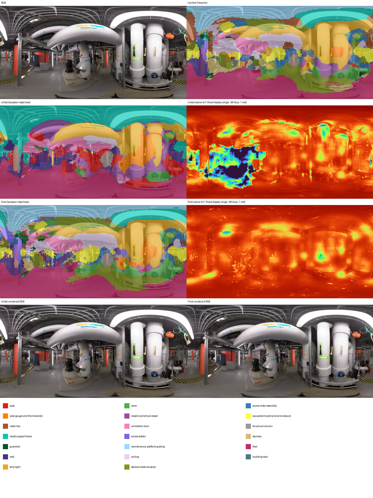
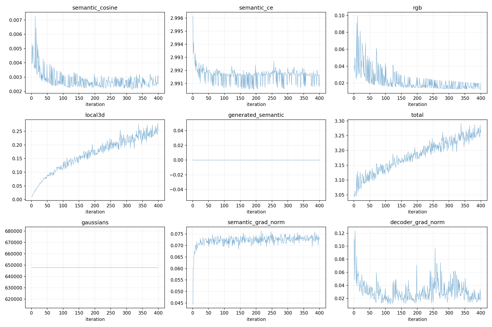

# M2 工业语义实验结果

当前结论：新数据流能够提取密集 CLIP 特征并训练高斯，但**不能据此宣称工业语义整体改善**。教师的部分空间响应更细，地面区域有所改善；白色管道、灯具、容器和立柱等仍明显混淆。学生能够学习教师，也会继承错误。

## 已完成的内容

- 实际查看全部 56 张训练 ERP+六透视面联系表，另做 6 处局部复核；每图独立 JSON 与 RGB 哈希绑定。
- 得到 20 类、97 条英文描述，见 [类别报告](IRIS_CLASS_ANALYSIS.md) 和 [最终词表](../configs/industrial_classes.json)。不使用外部 VLM，不将官方 mask 用作监督。
- 采用 3D-OVS 三尺度、重叠抖动矩形、原始 CLIP 向量空间累积/覆盖归一化，每张默认 16,812 个 patch；[实现依据及差异](M2_REFERENCE.md) 明确列出等权尺度融合和软目标 CE 的近似。
- C++ 显式读取缓存 S；保留 32 维高斯、32→512 映射、原渲染/反传及文本查询。
- 4 个真实训练视角的旧/新教师对比与 400 步高斯短训已完成并实际查看。全量缓存与完整 SGI 的状态以服务器各 `outputs.json` 为准；此版报告不预填未完成的结果。

## 二维教师的实际观察

对比图的上右图使用旧 12 类，底部有独立图例；其余语义图为新 20 类。中排使用同一组新文本，区分视觉特征变化；下排展示最终缓存 S，区分 raw cosine 与空间 min-max 的影响。

| 训练视角 | 真实内容 | 新版中的正确响应与剩余错误 |
|---|---|---|
| 10.18.46 | 红色建筑柱、白柜、桥架、灰地坪 | raw cosine 的地面和部分细支架响应更清楚；柱仍被混为容器，S 将大量柱面提升为袋垛；部分地面误报阀门 |
| 10.40.42 | 粗保温管、黑色竖泵、蓝罐 | 地面响应可辨；白管仍混为容器，仪表类响应范围过大，泵/管边界不可靠 |
| 11.22.19 | 两条粗白立管、黄色细仪表、黑泵、桥架 | 响应有更细的空间变化，但粗白管大面积被判成条灯/容器，仪表响应扩散到邻接管壁 |
| 11.26.42 | 白色柜式设备、白管、竖灯、支架 | 地面及竖灯有局部合理响应；白柜与墙/门混淆，管路与容器仍混淆 |

检查没有发现全景整体翻转或错位：矩形累积与参考逐像素加法一致，方向通道的真实正投影/逆映射、接缝、两极测试通过。逐尺度图也显示错误在多个尺度中存在。将透视图从 1024 提到 2048 的独立诊断没有稳定消除上述错误。

另以相同 F、仅使用标准名/基础模板的 T 做诊断。入口和管线图中地面等区域反而变差，没有解决柱/罐、管/灯混淆，因此保留正式多描述词表。该诊断验证了只改文本会复用 F，重建 T/S；没有将模板诊断当成正式类别定义。

目前证据更支持：局部 CLIP 图像向量对细工业物体的区分有限；逐类别空间 min-max 会把本来很弱、甚至该图未明显出现的类别响应提升到高值。尺度平均和图像级归一化带来的跨视角差异也可能影响监督，不能排除。既没有借助分割真值修正目标，也没有添加类别筛选规则。

## 400 步高斯短训

Run：`runs/industrial_semantics_20261023/02_gaussians/short_s0_400/03_semantic/s0`。

使用上述 4 个训练视角，从原 OmniGS 的 647,929 个高斯初始化；RGB 为 1024×512，语义为 256×128，32 维语义和解码头均参与优化，增密关闭。此实验检验数据流能否学习教师，不是完整场景训练或独立语义准确率评测。

| 四视角均值 | 初始 | 400 步 |
|---|---:|---:|
| 与教师 F 的余弦 | 0.995782 | 0.997389 |
| 与 S argmax 一致率 | 35.73% | 72.62% |
| 软目标 CE | 2.996186 | 2.991461 |
| 目标熵 | 2.990972 | 2.990972 |
| KL(教师概率 ∥ 学生概率) | 0.005213 | 0.000489 |
| 类概率 MAE | 0.004213 | 0.001234 |
| 有效高斯贡献像素比例 | 100% | 100% |

四视角最终一致率分别为 71.61%、75.02%、77.95%、65.91%。教师 S 的 softmax 接近均匀分布，少量分数变化就能改变 argmax；初始 F 余弦已经很高。因此不能把这些值解读为 72.62% 的真实分类正确率，也不能用高余弦说明物体类别正确。

同一视角的初始/最终渲染表明，学生已从 raw cosine 风格的初始分类向 S 目标移动；柱面袋垛、白管条灯等错误随之被学习，部分边界出现碎片。没有观察到整体渲染坐标错位。虽然语义 CE/余弦项下降，原有随机局部 3D 正则项从首步 0.00948 到末步 0.25461，导致总损失从 3.05032 升至 3.26836；本次未修改该既有正则，不能报告“所有损失下降”。

## 原生 S 接口与工程验证

在 M1 的 4,267 个真实增强点上固定 F、T、相机、初始化和随机种子，仅反转 S 的类别行：CE 从 2.996892929 变为 2.998967409；Lcos 均为 0.010161907。独立按原生初始 logits 计算的 CE 为 2.996892452。语义参数与解码层梯度非零。旧 `local_crops` 显式 hard-target S 路径也通过同样检查。

原生编译通过；5 项新密集特征测试及 2 项既有 M1 几何测试通过；真实 F/S/T 缓存检查通过；新词表数量不同的文本查询成功执行。历史实验请求缺少 S 时，不会在 C++ 中隐式退回 F/T 标签；两个历史回归脚本在各自测试目录显式补齐 S，保留旧实验文件。

完整运行入口与产物协议见 [M2_RUNBOOK.md](M2_RUNBOOK.md)。服务器根目录为 `/mnt/sda/ubuntu/lkx/od/OmniGS_SPCGS_20261023/`，本次材料根目录为 `runs/industrial_semantics_20261023/`。完整数组、模型和日志在服务器保存；Git 保存代码、配置、参考快照、观察记录及少量代表图。
