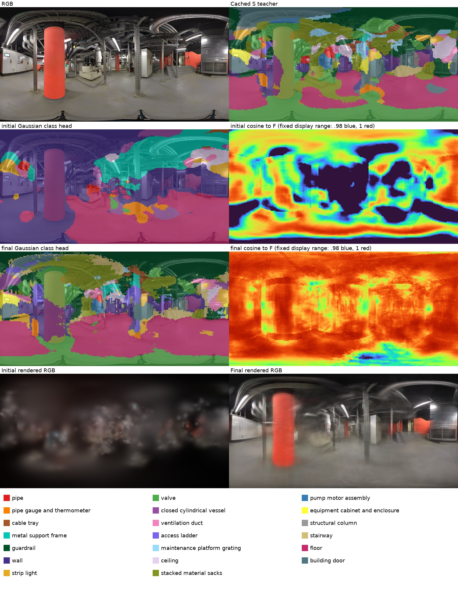
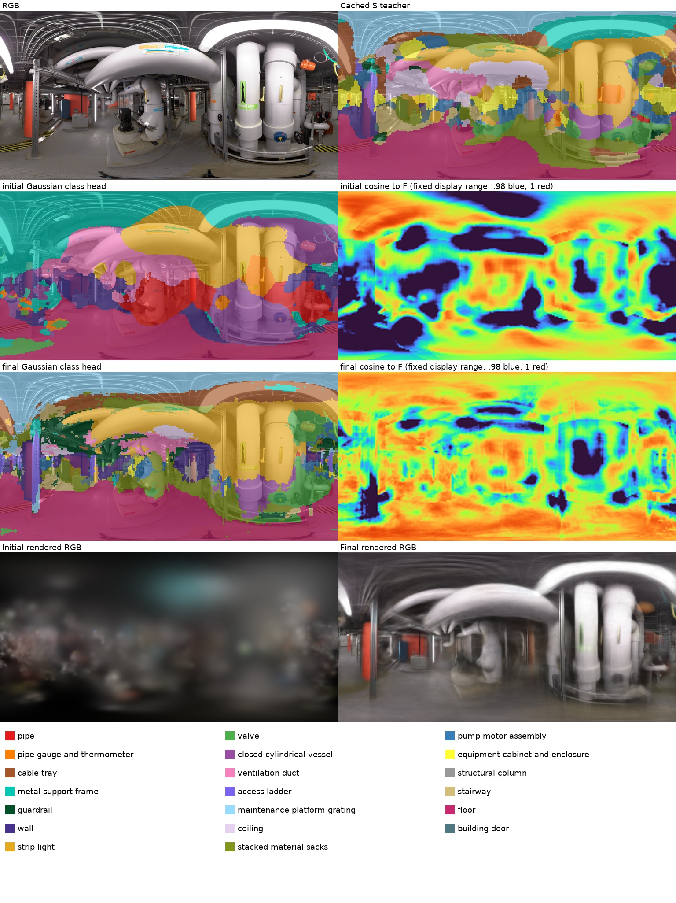
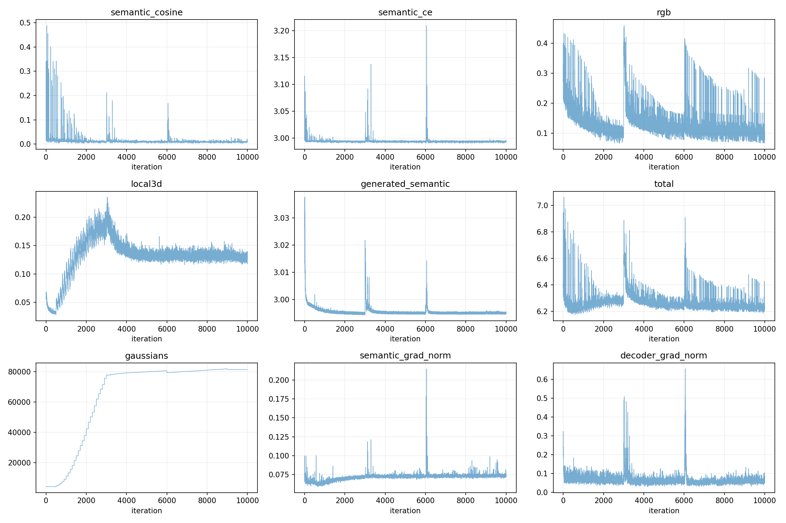
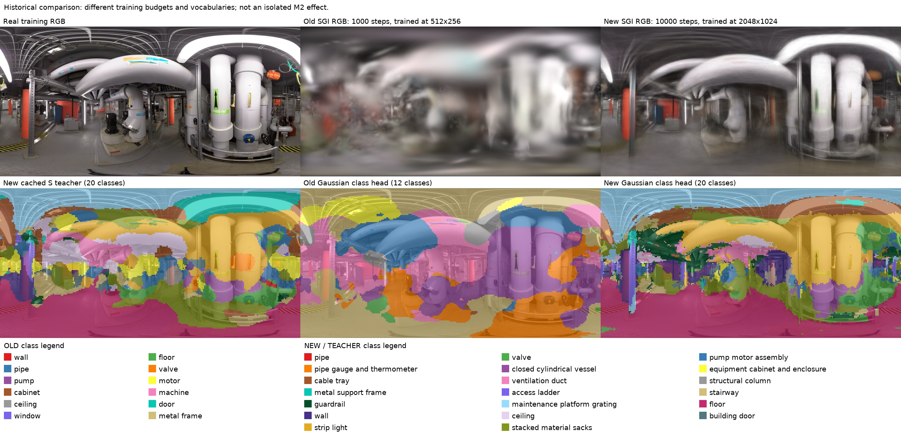

# M2 工业语义实验结果

当前结论：M2 实现、完整监督缓存、短训和 10,000 步 SGI 已完成，但**尚未达到工业语义整体改善的目标**。教师的部分空间响应更细，地面区域有所改善；白色管道、灯具、容器和立柱等仍明显混淆。学生能够学习部分教师响应，也会继承错误；完整 SGI 对教师的拟合仍不充分。

## 已完成的内容

- 实际查看全部 56 张训练 ERP+六透视面联系表，另做 6 处局部复核；每图独立 JSON 与 RGB 哈希绑定。
- 得到 20 类、97 条英文描述，见 [类别报告](IRIS_CLASS_ANALYSIS.md) 和 [最终词表](../configs/industrial_classes.json)。不使用外部 VLM，不将官方 mask 用作监督。
- 采用 3D-OVS 三尺度、重叠抖动矩形、原始 CLIP 向量空间累积/覆盖归一化，每张默认 16,812 个 patch；[实现依据及差异](M2_REFERENCE.md) 明确列出等权尺度融合和软目标 CE 的近似。
- C++ 显式读取缓存 S；保留 32 维高斯、32→512 映射、原渲染/反传及文本查询。
- 4 个真实训练视角的旧/新教师对比、400 步高斯短训及 10,000 步完整 SGI 均已完成并实际查看。56 张真实训练图和 M1 的 4 张注册生成图缓存均通过完整性检查，56 张真实图的缓存来源与逐图视觉分析 RGB 哈希全部一致。

## 二维教师的实际观察

对比图的上右图使用旧 12 类，底部有独立图例；其余语义图为新 20 类。中排使用同一组新文本，区分视觉特征变化；下排展示最终缓存 S，区分 raw cosine 与空间 min-max 的影响。

| 训练视角 | 真实内容 | 新版中的正确响应与剩余错误 |
|---|---|---|
| 10.18.46 | 红色建筑柱、白柜、桥架、灰地坪 | raw cosine 的地面和部分细支架响应更清楚；柱仍被混为容器，S 将大量柱面提升为袋垛；部分地面误报阀门 |
| 10.40.42 | 粗保温管、黑色竖泵、蓝罐 | 地面响应可辨；白管仍混为容器，仪表类响应范围过大，泵/管边界不可靠 |
| 11.22.19 | 两条粗白立管、黄色细仪表、黑泵、桥架 | 响应有更细的空间变化，但粗白管大面积被判成条灯/容器，仪表响应扩散到邻接管壁 |
| 11.26.42 | 白色柜式设备、白管、竖灯、支架 | 地面及竖灯有局部合理响应；白柜与墙/门混淆，管路与容器仍混淆 |

检查没有发现全景整体翻转或错位：矩形累积与参考逐像素加法一致，方向通道的真实正投影/逆映射、接缝、两极测试通过。逐尺度图也显示错误在多个尺度中存在。将透视图从 1024 提到 2048 的独立诊断没有稳定消除上述错误。

另以相同 F、仅使用标准名/基础模板的 T 做诊断。入口和管线图中地面等区域反而变差，没有解决柱/罐、管/灯混淆，因此保留正式多描述词表。该诊断验证了只改文本会复用 F，重建 T/S；没有将模板诊断当成正式类别定义。

另对入口与近景管线两张图将透视 FOV 从 100° 扩到 150°，检查 patch 上下文的影响。raw cosine 中红柱和部分白色直管出现更合理响应，但横向粗白管仍混为通风管；空间 min-max 后柱/袋垛、地面/阀门等错误仍明显，边界更粗。正式配置保留 100°；150° 结果独立保存在 `01_clip/features_fov150_diagnostic/` 与 `scales_fov150/`。100°、150° 的实际正反投影方向通道误差均通过 0.0006 上限测试。

目前证据更支持：局部 CLIP 图像向量对细工业物体的区分有限；逐类别空间 min-max 会把本来很弱、甚至该图未明显出现的类别响应提升到高值。尺度平均和图像级归一化带来的跨视角差异也可能影响监督，不能排除。既没有借助分割真值修正目标，也没有添加类别筛选规则。

## 400 步高斯短训

Run：`runs/industrial_semantics_20261023/02_gaussians/short_s0_400/03_semantic/s0`。

使用上述 4 个训练视角，从原 OmniGS 的 647,929 个高斯初始化；RGB 为 1024×512，语义为 256×128，32 维语义和解码头均参与优化，增密关闭。此实验检验数据流能否学习教师，不是完整场景训练或独立语义准确率评测。

| 四视角均值 | 初始 | 400 步 |
|---|---:|---:|
| 与教师 F 的余弦 | 0.995782 | 0.997389 |
| 与 S argmax 一致率 | 35.73% | 72.62% |
| 软目标 CE | 2.996186 | 2.991461 |
| 目标熵 | 2.990972 | 2.990972 |
| KL(教师概率 ∥ 学生概率) | 0.005213 | 0.000489 |
| 类概率 MAE | 0.004213 | 0.001234 |
| 有效高斯贡献像素比例 | 100% | 100% |

四视角最终一致率分别为 71.61%、75.02%、77.95%、65.91%。教师 S 的 softmax 接近均匀分布，少量分数变化就能改变 argmax；初始 F 余弦已经很高。因此不能把这些值解读为 72.62% 的真实分类正确率，也不能用高余弦说明物体类别正确。

同一视角的初始/最终渲染表明，学生已从 raw cosine 风格的初始分类向 S 目标移动；柱面袋垛、白管条灯等错误随之被学习，部分边界出现碎片。没有观察到整体渲染坐标错位。虽然语义 CE/余弦项下降，原有随机局部 3D 正则项从首步 0.00948 到末步 0.25461，导致总损失从 3.05032 升至 3.26836；本次未修改该既有正则，不能报告“所有损失下降”。

## 10,000 步完整 SGI

Run：`runs/industrial_semantics_20261023/02_gaussians/sgi_full_10000/02_sgi_gaussians`。

使用全部 56 个真实训练视角，以及 M1 已注册的 forward、backward、left、right 四个生成视角。从 M1 的 4,267 个增强点初始化，RGB 为 2048×1024，语义为 256×128，沿用每步真实图和生成图语义损失、既有增密/裁剪及局部 3D 正则。正式 CLIP 配置仍为 100°、1024 像素透视面。没有重新生成视频或重新执行 M1。

训练从头连续完成 10,000 步；逐步日志序号完整，所有记录中的数值有限。最终 **81,353 个高斯**。三次 OGR 在第 3,000/6,000/9,000 步分别删除 1,889/1,277/577 个点，共 3,743 个。第 3,000 和 6,000 步的透明度重置造成暂时损失上升，曲线保留这些过程。

| 四个固定训练代表视角的均值 | 初始 | 10,000 步 |
|---|---:|---:|
| 与教师 F 的余弦 | 0.985272 | 0.991994 |
| 与 S argmax 一致率 | 27.18% | 52.96% |
| 软目标 CE | 2.997910 | 2.992511 |
| 目标熵 | 2.990972 | 2.990972 |
| KL(教师概率 ∥ 学生概率) | 0.006938 | 0.001539 |
| 类概率 MAE | 0.004774 | 0.002114 |
| 有效高斯贡献像素比例 | 100% | 100% |

四视角最终教师一致率分别为 63.71%、44.87%、57.96%、45.32%。这些值衡量拟合 S，不是实际物体分类准确率。完整 SGI 的训练图数量、初始化、生成图监督和增密均与 400 步 S0 不同，不能将两者的 52.96% 与 72.62% 当成控制变量比较；但完整 SGI 尚未充分拟合教师这一限制需要保留。

16 个测试视角在 2048×1024 下的 RGB 指标为 **PSNR 17.8160 dB、SSIM 0.647190**。单独的入口训练参考视角 PSNR 为 21.1725 dB，这不是 56 张训练图的均值。未计算 LPIPS。IRIS 有官方语义标注，但本次没有建立与新 20 类词表对齐的独立评价协议，因此未报告 mIoU/mAcc。

实际查看全部四张最终对照图后，观察如下：入口地面响应较合理，红柱仍混为袋垛/容器；泵管区的顶部管线与容器/条灯混淆，黑泵及相邻管路边界不稳定；近景粗白管仍大面积变成条灯；柜式设备区的竖灯、地面较合理，但柜体仍混为墙/门等。RGB 已从稀疏初始点形成场景结构，但细管、设备细节和遮挡边界仍明显模糊。

原生 S 置换检查、映射层梯度、原版 RGB 对照及投影测试确认了监督数据流可用；完整 SGI 的拟合差距没有因此消失。二维教师本身的错误已被直接观察到；多视角目标差异、当前重建表达能力及既有局部正则各自的影响尚未分离，不能将全部问题归因于词表，也不能用继续增加训练次数来代替诊断。

末 100 步均值：RGB 0.105900、Lcos 0.009014、CE 2.993065、生成视角语义损失 2.994951、局部 3D 正则 0.129263、总损失 6.232193。局部正则与重置事件使曲线并非单调下降。

## 与旧 SGI 的历史对照

旧模型为 1,000 步、512×256、12 类；新模型为 10,000 步、2048×1024、20 类，初始化点云和其他训练设置也不同。两者在相同四个相机及相同显示分辨率重渲染，旧/新类别使用独立图例。该对照只提供历史参考，不能单独估计 M2 的收益。

入口和近景管线对照中，新 RGB 结构比旧 1,000 步模型更清楚，但仍偏模糊。新语义的地面响应更合理；旧模型在横向粗管上有部分正确的 pipe 响应，新模型却将其变为 strip light。两个模型均有明显错误，结果不支持“新版语义全面更好”。四张历史对照及两个训练配置保存在 `02_gaussians/history_full_10000/`。

## 原生 S 接口与工程验证

在 M1 的 4,267 个真实增强点上固定 F、T、相机、初始化和随机种子，仅反转 S 的类别行：CE 从 2.996892929 变为 2.998967409；Lcos 均为 0.010161907。独立按原生初始 logits 计算的 CE 为 2.996892452。语义参数与解码层梯度非零。旧 `local_crops` 显式 hard-target S 路径也通过同样检查。

原生编译通过；5 项新密集特征测试及 2 项既有 M1 几何测试通过；真实 F/S/T 缓存检查通过；新词表数量不同的文本查询成功执行。历史实验请求缺少 S 时，不会在 C++ 中隐式退回 F/T 标签；两个历史回归脚本在各自测试目录显式补齐 S，保留旧实验文件。

补充检查还确认原版 RGB 渲染的最大逐像素差为 **0**。但 `check_regression.py` 的严格断点恢复参数等价检查**未通过**：连续/恢复训练均到第 40 步，增密计数一致；7,029 个高斯中 2 行语义参数超出 0.0002 容差，最大差 0.0178565，其余参数最大差小于 0.0001。对应训练损失几乎一致。补查 3 个视角，float16 语义渲染特征平均绝对差为 1.28e-8～3.82e-8，logits 平均差为 2.93e-7～3.90e-7；存在半精度量化的单值差，不能把小平均误差等同于测试通过。近邻/深度排序及 GPU 数值非确定性可能有关，但原因未被完全定位。本次保留原渲染和优化器，没有放宽断言；完整 SGI 从头连续执行。失败模型、日志和补查结果保存在 `02_gaussians/regression_first/`。

完整运行入口与产物协议见 [M2_RUNBOOK.md](M2_RUNBOOK.md)。服务器根目录为 `/mnt/sda/ubuntu/lkx/od/OmniGS_SPCGS_20261023/`，本次材料根目录为 `runs/industrial_semantics_20261023/`。完整数组、模型和日志在服务器保存；Git 保存代码、配置、参考快照、观察记录及少量代表图。

机器可读的完成状态、缓存引用、检查结果、训练指标及模型 SHA256 见 [M2_EXPERIMENT.json](M2_EXPERIMENT.json)，服务器另存 `runs/industrial_semantics_20261023/delivery_manifest.json`。完整 SGI 最终模型为上述 run 下的 `final/model.pt`，SHA256 为 `1f52ba9c6410cce3c8f960def5f08d67fe710576a06a134663bb323a8f189641`。初始/最终模型、每 1,000 步检查点、语义参数、映射头、渲染、连续 S 与概率/相关性数组均保留。
