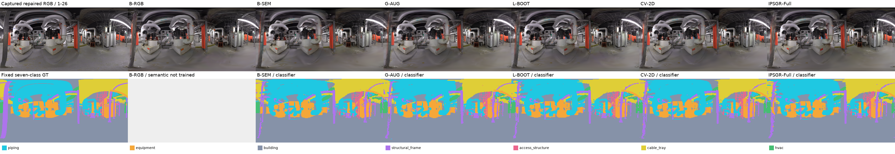
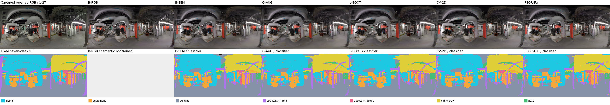
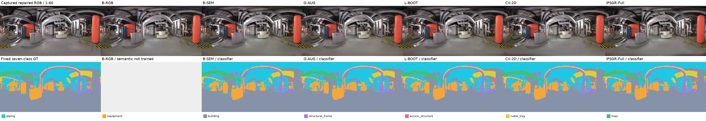
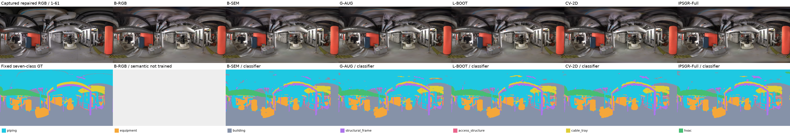
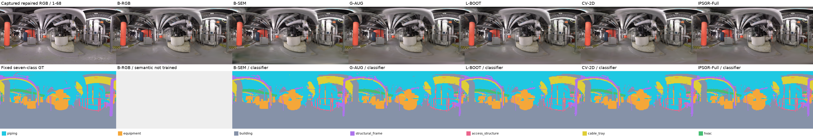
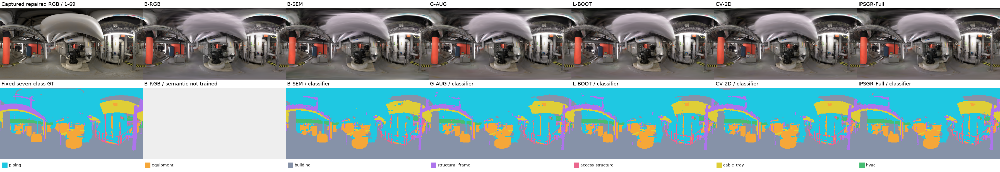

# IPSGR：修复后 IRIS 20/6 七类实验结果

本轮已于 2026-10-26 02:05（北京时间）完成。固定 20 张训练、6 张测试，不设验证集；80 个全新 Wan360 视频、ISLB 和六组正式模型均已完成。正式模型各训练 10,000 步，ISLB 额外训练 10,000 步。

- [完整中文报告（GitHub 可直接阅读）](10_report/report.md)
- [运行说明](../IPSGR_REPAIRED20_6.md)
- [六组指标 CSV](09_paper_tables/T02.csv)
- [全部逐图指标](09_paper_tables/S_all_view_metrics.csv)
- [完成审计](10_report/completion_audit.json)
- [图表目录与矢量文件](08_paper_figures/)
- [原始服务器产物及检查点索引](10_report/server_artifacts.json)
- [发布文件 SHA256 清单](publication_manifest.json)

|模型|PSNR ↑|SSIM ↑|LPIPS ↓|七类 mIoU ↑|
|---|---:|---:|---:|---:|
|B-RGB|22.2181|0.7349|**0.3417**|—|
|B-SEM|21.9863|0.7295|0.3838|79.45%|
|G-AUG|22.2944|0.7318|0.3779|78.87%|
|L-BOOT|**22.4779**|**0.7395**|0.3590|78.75%|
|CV-2D|22.4049|0.7358|0.3628|**80.10%**|
|IPSGR-Full|22.2819|0.7354|0.3640|79.52%|

主语义为原生 256×128，RGB 为 2048×1024。总体 mIoU 使用六张测试图累计混淆矩阵。CV-2D → IPSGR-Full 的 mIoU 下降约 0.58 个百分点；这次结果不支持完整方法在所有指标上最优。固定七类标签包含官方投影、人工指令下的类别合并及修复衍生标签，并非未经修改的官方原始真值。F10 可选输入数量实验未执行。

## 浏览交互页面

GitHub 文件页不直接运行 HTML/JavaScript。克隆或下载仓库后，在仓库根目录运行：

```bash
python -m http.server 8879 --bind 127.0.0.1
```

然后打开：

- [完整 HTML 报告](http://127.0.0.1:8879/docs/ipsgr_repaired20_6/10_report/report.html)
- [六张测试图与类别查询浏览器](http://127.0.0.1:8879/docs/ipsgr_repaired20_6/10_report/viewer.html)

支持切换六组模型、六张测试图及七类固定文本原型响应。所有页面引用的本地显示资源均包含在此目录；报告、预测 PNG 和指标从已完成运行逐字节复制，未重新计算或修改实验结果。清单中的服务器绝对路径用于追溯原始产物，在其他机器上需按运行说明接入数据。原始数据集、模型权重、视频、浮点缓冲和全部 ISP 中间产物仍保存在服务器。

## 六张测试图的全模型对照

每图第一行为 RGB，第二行为七类语义；列顺序为真值、B-RGB、B-SEM、G-AUG、L-BOOT、CV-2D、IPSGR-Full。B-RGB 不含语义预测。

### 1-26



### 1-27



### 1-60



### 1-61



### 1-68



### 1-69


